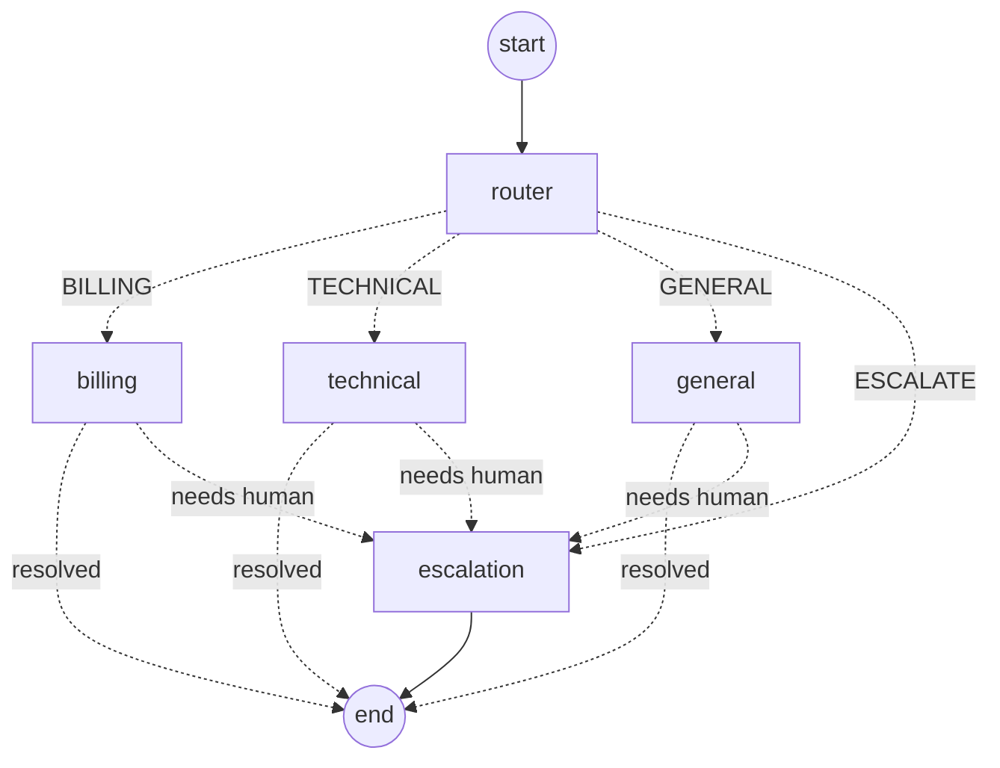

# Multi-Agent Customer Support System

A Spring Boot service that answers customer support requests with a team of agents
orchestrated by [LangGraph4j](https://github.com/langgraph4j/langgraph4j), the Java port of LangGraph.

## How it works



| Agent | Role |
|---|---|
| **Router** (supervisor) | Classifies the message as `BILLING`, `TECHNICAL`, `GENERAL` or `ESCALATE`. Safety rules (asking for a human, legal threats, strong anger) always win; otherwise the LLM classifies, with keyword scoring as a fallback. |
| **Billing** | Looks up the customer's account and invoices, explains charges and plans, refunds duplicate charges. Refunds above `support.escalation.refund-limit` (default $500) go to a human. |
| **Technical** | Grounds its troubleshooting steps in a knowledge base. Escalates when nothing matches and no LLM is available. |
| **General** | FAQs: hours, contact details, cancellation, privacy, feedback. |
| **Escalation** | Opens a ticket in the human queue with a priority (urgent for legal/angry, high for Enterprise customers) and tells the customer what happens next. |

All agents share one `SupportState` (customer, message, category, response, escalation flags,
ticket id and an execution `trace`). Each specialist may return `[ESCALATE] reason` from the LLM
to hand the conversation to a human.

### LLM or offline

Set `ANTHROPIC_API_KEY` and the agents use Claude through LangChain4j (model set by
`ANTHROPIC_MODEL`, default `claude-sonnet-5-5`). Without a key every agent runs on
deterministic rules, so the app and tests work with no network access. LLM errors fall
back to the rules too.

## Run it

Requires Java 17+. The Maven wrapper is included.

```bash
# Windows (PowerShell)
$env:ANTHROPIC_API_KEY="sk-ant-..."   # optional
.\mvnw.cmd spring-boot:run

# macOS / Linux
export ANTHROPIC_API_KEY=sk-ant-...   # optional
./mvnw spring-boot:run
```

Run the tests with `./mvnw test`.

## API

| Method | Path | Description |
|---|---|---|
| `POST` | `/api/support/chat` | Run a message through the agent graph |
| `GET` | `/api/support/tickets` | Tickets waiting for a human |
| `GET` | `/api/support/graph` | The graph as a Mermaid diagram |
| `GET` | `/api/support/health` | Status and whether the LLM is enabled |

```bash
curl -X POST http://localhost:8080/api/support/chat \
  -H "Content-Type: application/json" \
  -d '{"customerId": "C-1002", "message": "I need a refund of $899"}'
```

```json
{
  "customerId": "C-1002",
  "category": "BILLING",
  "handledBy": "escalation",
  "response": "I've passed your request to a member of our support team (ticket TCK-1001, priority high). ...",
  "escalated": true,
  "escalationReason": "Refund of $899 exceeds the $500 approval limit",
  "ticketId": "TCK-1001",
  "trace": [
    "router: BILLING (Keyword match (billing=1, technical=0))",
    "billing: escalating (Refund of $899 exceeds the $500 approval limit)",
    "escalation: opened TCK-1001 (HIGH)"
  ]
}
```

More messages to try:

| Customer | Message | Outcome |
|---|---|---|
| `C-1001` | What is on my latest invoice? | Billing answers from the account |
| `C-1003` | I was charged twice, please refund me | Billing finds the duplicate and refunds it |
| `C-1001` | I forgot my password and can't log in | Technical answers from KB-101 |
| any | What are your opening hours? | General answers from the FAQ |
| any | This is unacceptable, I want a manager | Straight to a human, urgent priority |

Demo customers `C-1001` (Pro), `C-1002` (Enterprise, overdue invoice) and `C-1003` (Basic,
duplicate charge) live in `CustomerAccountService`. Accounts, the knowledge base and the
ticket queue are in-memory; swap them for real systems behind the same services.

## Project layout

```
src/main/java/com/customersupport
├── agent/     RouterAgent, BillingAgent, TechnicalSupportAgent, GeneralAgent, EscalationAgent
├── graph/     SupportState, Category, SupportGraph (LangGraph4j wiring)
├── llm/       LlmClient (LangChain4j Anthropic, optional)
├── service/   CustomerAccountService, KnowledgeBase, TicketService
└── web/       SupportController and DTOs
```
